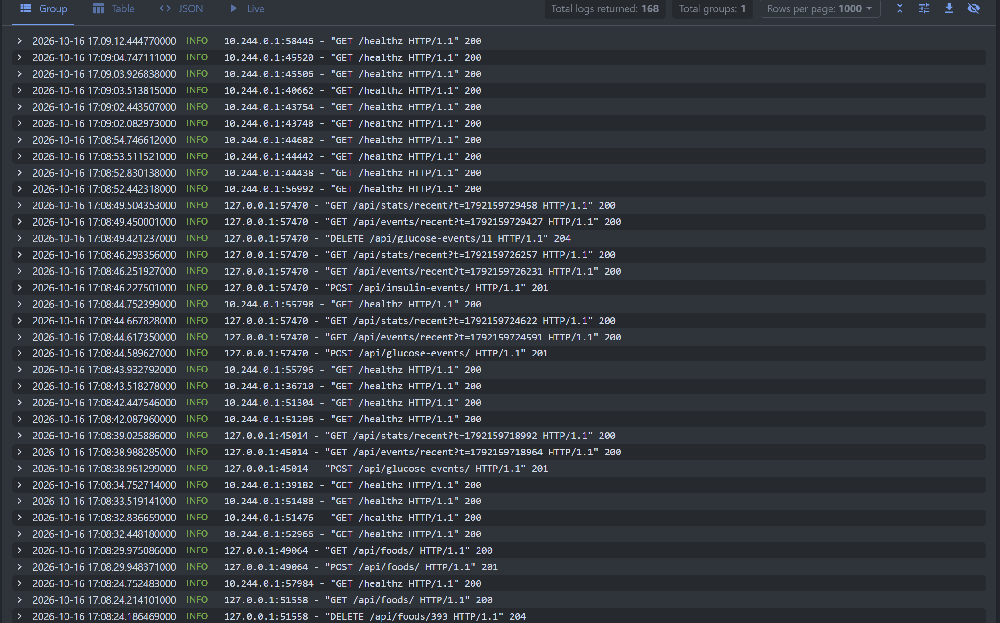
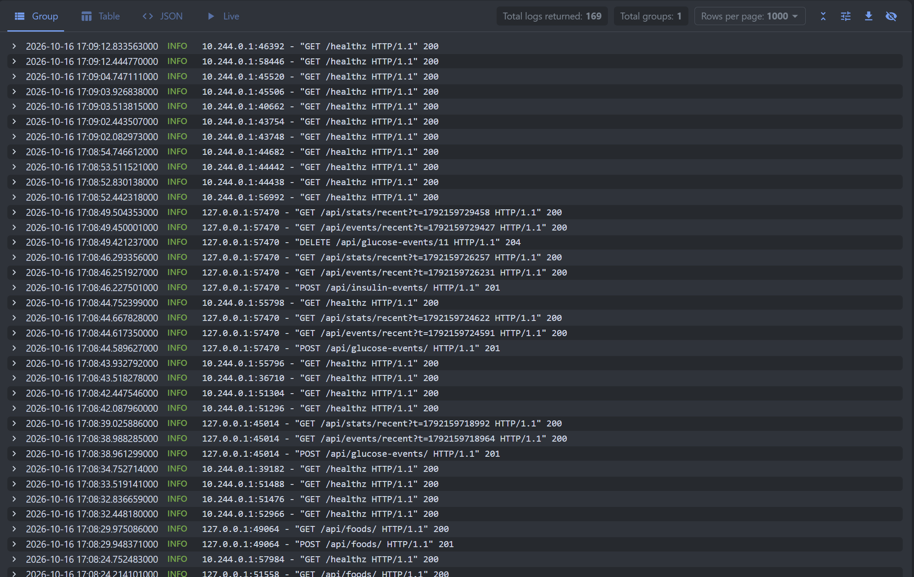
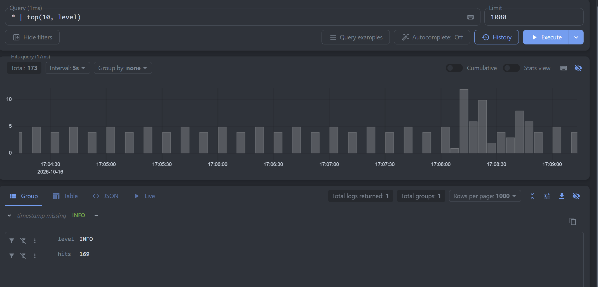
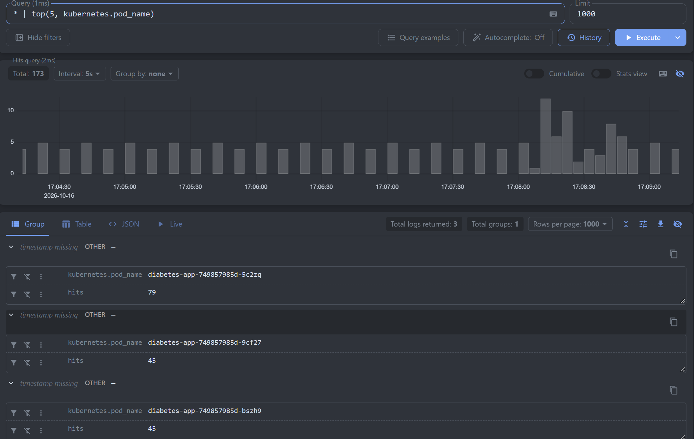

# Развёртывание Victoria Logs

Victoria Logs развёрнута в миникубе через Helm чарт victoria-logs-single 
Доступ к веб-интерфейсу vmui осуществляется через kubectl port-forward 

# Формат логов приложения

Приложение переведено на JSON формат логирования в stdout. Каждый лог содержит вот такие поля:
timestamp - время в ISO-8601
level - уровень лога (INFO, ERROR)
message - текст сообщения
service.name - имя сервиса (diabetes-diary)
logger - имя логгера (app.main, uvicorn.access)

Также в Dockerfile добавлена переменная PYTHONUNBUFFERED=1 для отключения буферизации stdout.

# Доставка логов через Fluent Bit

Для доставки логов выбран Fluent Bit. Основные причины почему выбрали его:
Лёгкий и быстрый с минимальным потреблением ресурсов
Нативная поддержка парсинга json и добавления метаданных 
Простая конфигурация через ConfigMap
Стандартный подход для сбора логов контейнеров

# Описание запросов

# 1. Сырые записи за последние минуты

Запрос: _time: 5m

Запрос выводит все логи приложения за последние 5 минут
Видны health check запросы от кубера и пользовательские действия 
Каждое сообщение содержит распаршенные поля _msg, level, service.name, logger и метаданные 

# 2. Фильтр по конкретному полю

Запрос: level:INFO

Запрос фильтрует логи по полю level, показывая только информационные сообщения
Показывает возможность фильтрации по распаршенным полям json, а не по полнотекстовому поиску

# 3. Агрегация с группировкой

Запрос: * | top(10, level)

Запрос агрегирует логи по полю level и показывает количество записей для каждого уровня 
У нас только информационные, ошибок и дебага не было

# 4. Топ подов по количеству логов

Запрос: * | top(5, kubernetes.pod_name)

Запрос показывает топ 5 подов по количеству сгенерированных логов 
Видны 3 пода приложения, нагрузка распределена между ними 
Так можно выявить дисбаланс нагрузки и проблемные места
